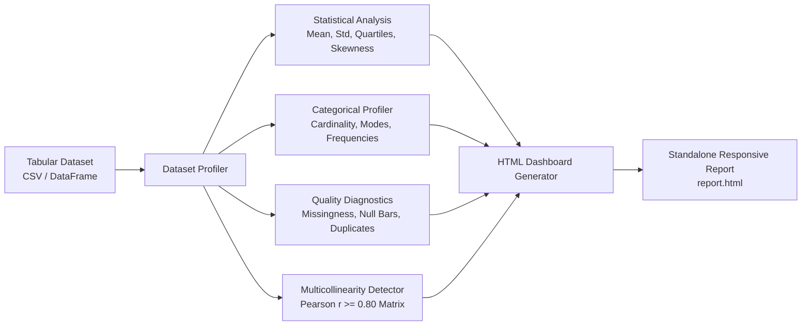

# EDA Insights Toolkit

[](https://www.python.org/downloads/)
[](https://opensource.org/licenses/MIT)
[](https://docs.pytest.org/)
[](https://pandas.pydata.org/)
[](https://github.com/piyush1008-cyber/eda-insights-toolkit)

> **Automated Exploratory Data Analysis (EDA) engine in Python.** Computes comprehensive parametric statistics, data quality metrics, missingness breakdowns, Pearson correlation matrices, and renders self-contained, responsive HTML data visualization dashboards.

---

## Architectural Flow



---

## Key Features

- **Automated Parametric Profiling:** Computes mean, standard deviation, min, 25th percentile, median, 75th percentile, max, and skewness for numeric attributes.
- **Categorical Diagnostics:** Profiles distinct values, high-frequency modes, and distribution frequencies.
- **Data Quality & Missingness Audits:** Highlights missing cells, missing percentages, and duplicate row detection.
- **Multicollinearity Flagging:** Automatically scans numeric correlation matrices to flag redundant pairs ($|r| \ge 0.80$) for feature selection.
- **Zero-Dependency HTML Reporting:** Renders modern, responsive HTML reports with dark mode styling and zero external runtime dependencies.

---

## Quickstart & CLI Commands

### 1. Run Automated Demonstration
```bash
python main.py demo
```
Generates a realistic customer dataset, conducts profiling, and outputs an interactive HTML report to `reports/eda_report.html`.

### 2. Profile an Existing CSV File
```bash
python main.py profile data/train.csv --out dashboard.html --threshold 0.85
```

---

## Running the Test Suite

```bash
pytest -v
```

Unit and integration tests verify:
- Parametric calculations (mean, std, quartiles, skewness)
- Missing value percentage accuracy and duplicate detection
- Collinear feature pair isolation
- HTML template compilation and file export.

---

## Author & License

- **Author:** Piyush Kangle ([@piyush1008-cyber](https://github.com/piyush1008-cyber))
- **Email:** piyushkangle@gmail.com
- **License:** [MIT License](LICENSE)
